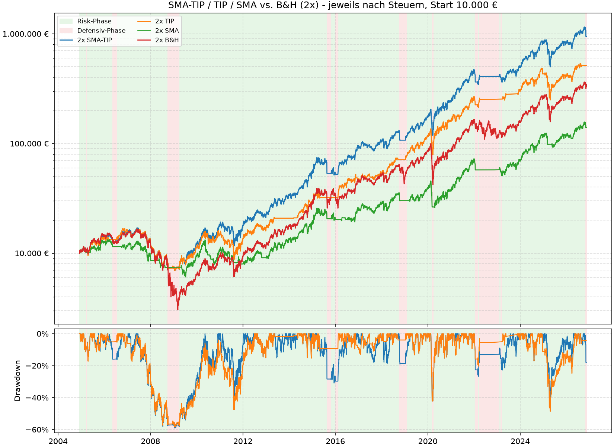
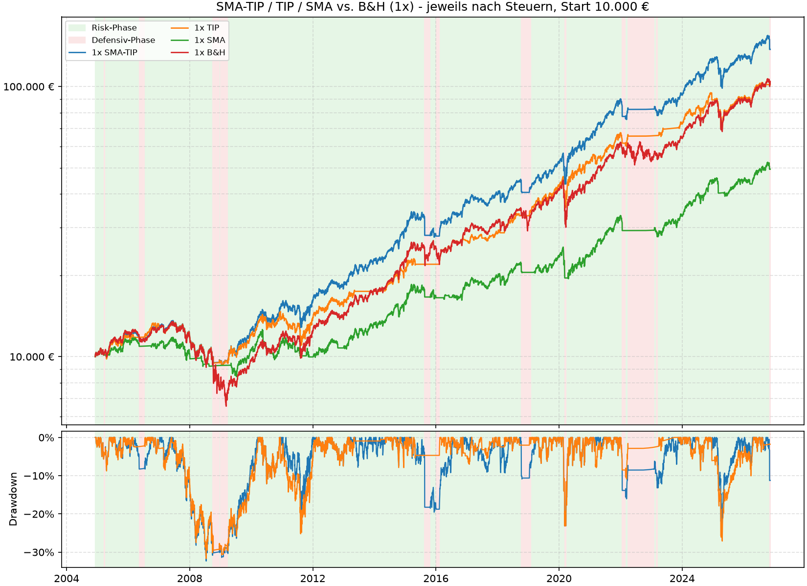
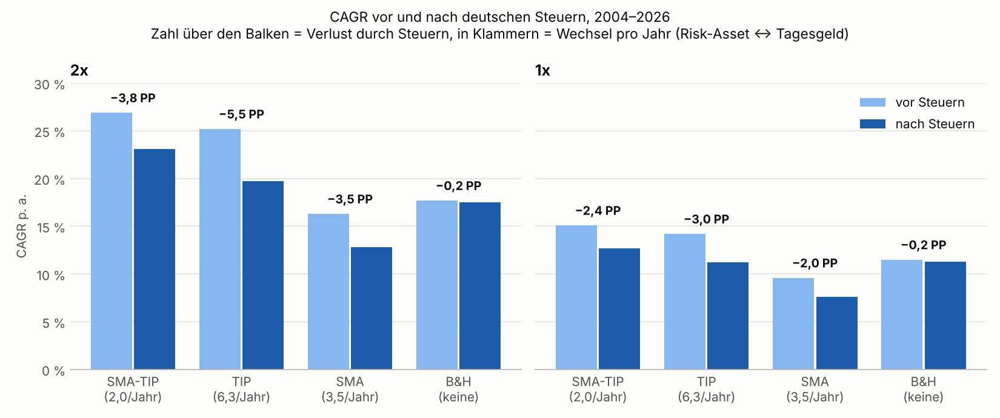
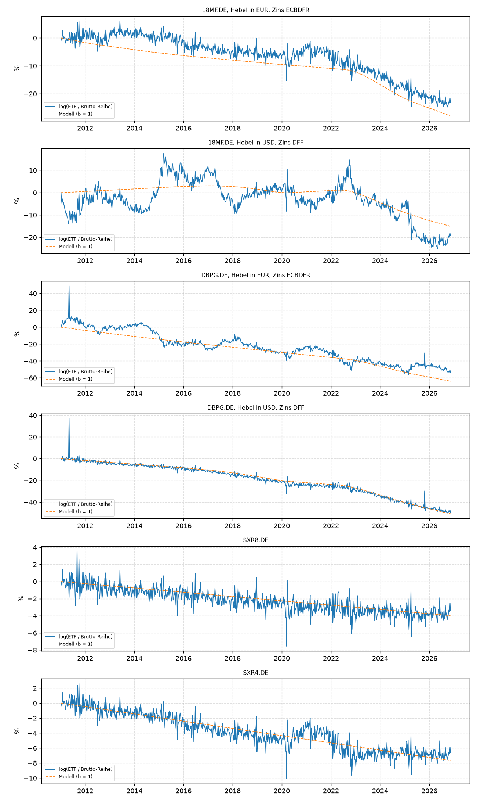
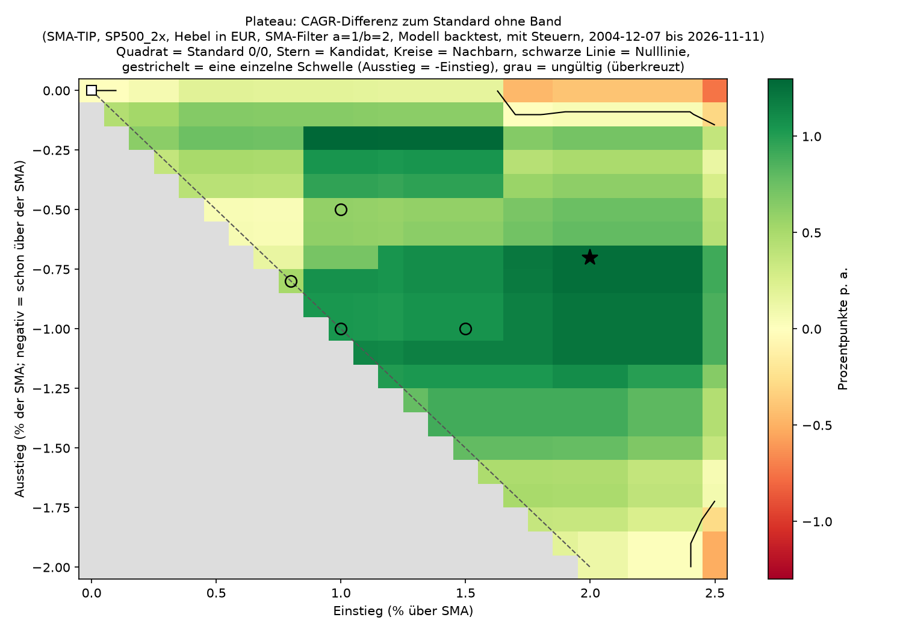
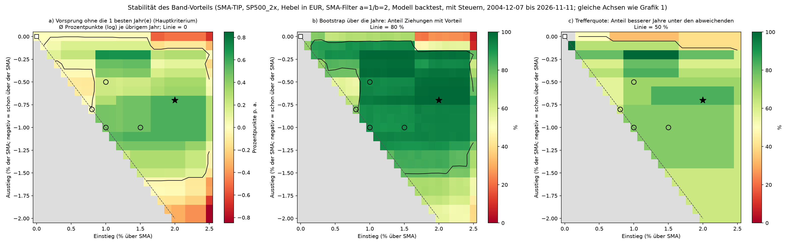
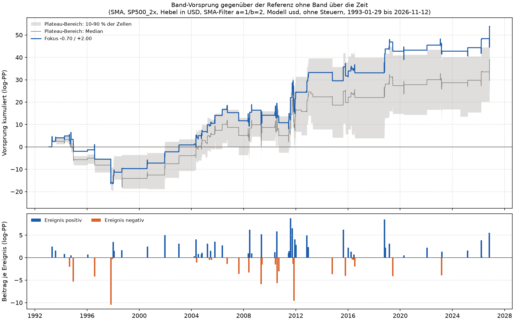

# SMA-TIP: steuerbewusste taktische Allokation

**SMA-TIP** ist ein regelbasiertes Signal, das börsentäglich sagt, ob ein (gehebelter) Aktien-ETF
oder Tagesgeld gehalten werden soll. Das Repository enthält

- das **Live-Signal** (`canary.py`), das nach US-Börsenschluss läuft und eine Push-Nachricht schickt,
- einen **Backtest** mit deutscher Steuerlogik (`backtest.py`, rein synthetisch),
- ein Werkzeug für die **Depotauswertung** (`stats.py`),
- die **zentralen Strategie-Parameter** (`strategie.toml`), die Live-Signal und Backtest gemeinsam nutzen.

> **Hinweis:** Dies ist ein Entscheidungshilfe-Projekt und keine Anlageberatung.
> Alle Ergebnisse beruhen auf historischen Daten und einem vereinfachten Modell.
> Qualitative Aussagen (Richtung, Rangfolge) sind belastbarer als exakte Zahlen.
> Hebelprodukte können hohe Verluste erzeugen (im Backtest bis fast 60 % Drawdown).

---

## Auf einen Blick



- Mit einem 2x gehebelten S&P 500 kam SMA-TIP von Dezember 2004 bis November 2026 nach deutschen Steuern auf
  **23,1 % CAGR** gegenüber 17,5 % bei Buy & Hold, bei einem Max. Drawdown von −59 % statt −82 %.
- SMA-TIP wechselt nur rund **2-mal pro Jahr** zwischen Aktien-ETF und Tagesgeld. Das ist der Hauptgrund, warum es
  unter der deutschen Abgeltungsteuer klar vor dem reinen TIP-Signal liegt (19,7 %, rund 6 Wechsel pro Jahr).
  Vor Steuern liegen beide fast gleichauf.
- Der Vorteil entsteht in wenigen Krisen (2008, 2016, 2018, 2020, 2022). In Erholungsjahren wie 2019 und 2023 liegt
  Buy & Hold vorn.

---

## Die Strategie

### Idee in einem Satz

Man ist investiert (**RISK**), solange *mindestens eines* von zwei Signalen grünes Licht gibt,
und geht erst ins Tagesgeld, wenn *beide* schlecht stehen.

### Die zwei Signale

| Signal | Regel | Rolle |
|---|---|---|
| **TIP-Canary** | 13612U-Momentum des ETFs `TIP` (inflationsgeschützte US-Anleihen) **> 0** → RISK | Makro-Frühwarnung über Zinsen und Inflation |
| **Trend (SMA)** | Schlusskurs des `^NDX` (Nasdaq 100) gegen seinen 200-Tage-Durchschnitt, mit Band: RISK endet bei Kurs ≤ SMA × 1,007, beginnt wieder bei Kurs > SMA × 1,02 | klassischer Trendfilter |

**13612U-Momentum** (Keller): Mittelwert der Kursänderungen über 1, 3, 6 und 12 Monate,
gerechnet in Handelstagen (21/63/126/252):

```
Score = 1/4 · [ (P0/P21 − 1) + (P0/P63 − 1) + (P0/P126 − 1) + (P0/P252 − 1) ]
```

### Kombination („Hybrid“, SMA-TIP)

```
Regime = RISK       wenn TIP-Signal = RISK  ODER  SMA-Signal = RISK
Regime = DEFENSIV   nur wenn beide Signale nicht RISK melden (gehalten wird dann Tagesgeld)
```

Die ODER-Verknüpfung ist der Kern: Das Trendsignal wirkt praktisch nur dann, wenn das
TIP-Signal bereits defensiv ist. Dadurch wechselt der Hybrid mit etwa **2 Wechseln pro Jahr**
deutlich seltener als die Einzelsignale (TIP rund 6, SMA rund 3,5).

### Wie die zwei Signale zusammenwirken

`backtest.py` teilt alle Handelstage nach dem Zustand der beiden Signale in vier Gruppen und misst, wie sich das
2x-Asset (S&P 500) in jeder Gruppe entwickelt hat (vor Steuern und Kosten, Dez. 2004 bis Nov. 2026):

| TIP-Signal | Nasdaq 100 gegen SMA200 | Anteil der Zeit | Rendite p. a. (2x) | SMA-TIP hält |
|---|---|---|---|---|
| Risk | darüber | 58 % | +27 % | Aktien-ETF |
| Risk | darunter | 14 % | **+84 %** | Aktien-ETF |
| Defensiv | darüber | 17 % | +6 % | Aktien-ETF |
| Defensiv | darunter | 10 % | **−54 %** | Tagesgeld |

Die Tabelle erklärt die ODER-Regel:
- Nur wenn **beide** Signale schlecht stehen, wird es gefährlich. In diesen 10 % der Zeit lagen die großen Verluste
  (2008, Anfang 2016, Ende 2018, März 2020, 2022). Genau dann hält SMA-TIP Tagesgeld.
- Das **TIP-Signal** wird oft schon nach einem Crash wieder positiv, während der Index noch unter seiner SMA liegt.
  Diese Phasen waren die stärksten überhaupt (+84 % p. a., meist frühe Erholungen). Eine reine SMA-Strategie
  verpasst sie.
- Meldet nur TIP Gefahr, der Trend ist aber intakt, ging es im Schnitt leicht aufwärts (+6 % p. a.). Hier
  auszusteigen, wie es das reine TIP-Signal tut, bringt wenig und kostet Wechsel und damit Steuern.

### Whipsaw-Filter (Bestätigung)

Ein neues Signal gilt erst nach mehreren aufeinanderfolgenden Handelstagen als bestätigt:

| Signal | Weg von RISK | Hin zu RISK |
|---|---|---|
| TIP | 1 Tag | 2 Tage |
| SMA | 1 Tag | 2 Tage |

### Band um die SMA

Das SMA-Signal hat ein Band (Hysterese), das **vor** dem Whipsaw-Filter wirkt:

```
RISK -> nicht RISK   sobald Schlusskurs <= SMA200 x 1,007   (höchstens 0,7 % über der SMA)
nicht RISK -> RISK   sobald Schlusskurs >  SMA200 x 1,020   (mehr als 2 % über der SMA)
dazwischen           bleibt der vorherige Zustand
```

Der Ausstieg kommt also etwas vor dem Unterschreiten der SMA, der Wiedereinstieg erst mit Abstand darüber. Das verhindert
viele Fehleinstiege knapp über der SMA. Herleitung und Grenzen stehen unter [Wahl der Parameter](#wahl-der-parameter).
Die Werte stehen in `strategie.toml` (`band_ausstieg_pct = -0.7`, `band_einstieg_pct = 2.0`); 0/0 schaltet das Band aus.
`canary.py` zeigt im Fazit den Indexstand, ab dem der nächste Schlusskurs die Schwelle erreicht (für einen Kursalarm).

### Was gehalten wird

- **RISK:** ein Risk-ETF aus der Kandidatenliste in `canary.py` (`RISK_TICKERS`: 2x-ETFs auf S&P 500, MSCI USA,
  MSCI World und MSCI ACWI). Gewählt wird **einmal zu Beginn der Risk-Phase** der Kandidat mit dem höchsten
  13612U-Momentum, gehalten wird er bis zum Phasenende.
- **DEFENSIV:** Tagesgeld. Es gibt keine Defensiv-ETFs. Der Backtest verzinst Risk-off-Phasen mit dem
  EZB-Einlagensatz abzüglich 0,25 % (nie unter 0 %). Ein Defensiv-ETF lohnt sich bei den vielen kurzen Phasen und den
  Spreads nicht.

**Momentum der Risk-Kandidaten:** normales 13612U-Momentum auf den Kursen der letzten 21/63/126/252 Handelstage, wie beim
Canary TIP (Fallbackkette 136U → 13U → 1U → längste Historie, wenn die Historie eines Kandidaten nicht reicht). Es ist
unabhängig vom Regime, auch über Tagesgeld-Phasen hinweg.

- **Zweistufige Abfrage:** Stufe 1 lädt TIP und `^NDX` über eine lange Historie (`REGIME_HISTORY_YEARS` = 10 plus Einlaufzeit)
  und liefert die Regime-Historie. Stufe 2 bestimmt daraus den Beginn der aktuellen Risk-Phase und lädt die Kandidaten ab
  einem Datum rund 252 Handelstage davor. Im Regime DEFENSIVE werden die Kandidaten nur zur Information geladen
  (Momentum-Tabelle, Spitzenreiter); die Empfehlung bleibt Tagesgeld.
- **Auswahl zum Phasenbeginn:** Das Script leitet den Phasenbeginn bei jedem Lauf aus der Regime-Historie ab (kein
  gespeicherter Zustand) und gibt als „Gehalten“ das Asset aus, das zu Phasenbeginn vorn lag. Daneben steht „Heute vorn“
  (heutiger Spitzenreiter, nur zur Information) und die Momentum-Tabelle mit beiden Markierungen. Die Push-Nachricht zeigt
  als „Empfehlung“ den heutigen Spitzenreiter (Ticker im Titel, Name im Text), nicht das gehaltene Asset.
- **Hebel:** Die Kandidaten werden ohne Hebel-Anpassung verglichen, der Pool enthält deshalb nur 2x-Produkte. Ein 1x-Produkt
  (z. B. `XDEM.DE`) wurde entfernt: In einem Test der Auswahl zu den Phasenbeginnen mit echten Kursen wurde es nach Crashs
  bevorzugt und kostete in der Erholung viel Rendite. Derselbe Test zeigte bei gleich gehebelten Kandidaten keinen belastbaren
  Unterschied zwischen Kalender-Momentum und einem Momentum nur aus Risk-Tagen, daher die einfachere Methode. Die Auswahl
  hat insgesamt wenig Einfluss (die Kandidaten sind sehr ähnlich), die Stichprobe umfasst nur rund 12 Phasen. Alle
  Backtests verwenden ein festes S&P-500-Asset.

### Ausführung

Das Script läuft nach US-Börsenschluss (Sicherheitspuffer bis 16:05 New Yorker Zeit).
Das mit dem **heutigen** Schlusskurs bestätigte Regime ist die Grundlage für die Order am Abend.
Im Backtest wirkt das Signal von Tag *d−1* an Tag *d* (kein Look-Ahead).

---

## Ergebnisse des Backtests

Quelle: `backtest.py`, Stand 11. November 2026, Zeitraum 7. Dezember 2004 (erstes TIP-Signal) bis 11. November 2026.
Das Risk-Asset ist ein synthetischer S&P 500 aus `SPY` in EUR, 2x mit Hebel in EUR wie `18MF.DE` bzw. 1x wie `SXR8.DE`
(Kalibrierung siehe [unten](#kalibrierung-des-hebel-modells)). Risk-off-Phasen als Tagesgeld, Spreads modelliert.
„Nach Steuern“ heißt: Abgeltungsteuer bei jedem Verkauf (nach 30 % Teilfreistellung) und Vorabpauschale;
„vor Steuern“ rechnet beides heraus. Verglichen werden SMA-TIP, die beiden Einzelsignale (TIP, SMA) und Buy & Hold (B&H).

### Übersicht

| | CAGR nach Steuern | CAGR vor Steuern | Steuerlast | Max. Drawdown | Sortino | Wechsel pro Jahr |
|---|---|---|---|---|---|---|
| **2x SMA-TIP** | **23,1 %** | 26,9 % | −3,8 PP | −59,0 % | 1,11 | 2,0 |
| 2x TIP | 19,7 % | 25,2 % | −5,5 PP | −58,4 % | 1,04 | 6,3 |
| 2x B&H | 17,5 % | 17,7 % | −0,2 PP | −81,7 % | 0,86 | – |
| 2x SMA | 12,8 % | 16,3 % | −3,5 PP | −54,5 % | 0,81 | 3,5 |
| **1x SMA-TIP** | **12,7 %** | 15,1 % | −2,4 PP | −32,3 % | 1,10 | 2,0 |
| 1x B&H | 11,3 % | 11,5 % | −0,2 PP | −51,4 % | 0,91 | – |
| 1x TIP | 11,2 % | 14,2 % | −3,0 PP | −31,7 % | 1,07 | 6,3 |
| 1x SMA | 7,6 % | 9,6 % | −2,0 PP | −28,5 % | 0,84 | 3,5 |

Max. Drawdown und Sortino jeweils nach Steuern. Sortino = annualisierte Rendite geteilt durch die Abwärtsschwankung (nur
Tage mit Verlust zählen als Risiko). Er passt besser zu einer Strategie, die gezielt Verluste vermeiden will, als der
Sharpe-Wert, der auch Aufwärtsschwankungen bestraft (der steht weiter in der Ausgabe von `backtest.py`).
Ein Wechsel ist ein Übergang Aktien-ETF ↔ Tagesgeld; jeder zweite Wechsel ist ein Verkauf.

### 2x gehebelt (Hauptfall)

Die Grafik steht oben unter [Auf einen Blick](#auf-einen-blick): oben der Depotverlauf ab 10.000 € (logarithmisch),
darunter der Drawdown von SMA-TIP und TIP; grün hinterlegt die Risk-Phasen, rot die Tagesgeld-Phasen von SMA-TIP.

- **Wo der Vorsprung entsteht:** In 11 von 23 Kalenderjahren (2004 und 2026 angebrochen) sind SMA-TIP und Buy & Hold
  identisch, weil SMA-TIP durchgehend investiert war. Die Unterschiede kommen aus wenigen Phasen: 2008 (+23 PP gegenüber
  B&H), 2009 (+19), 2016 (+41), 2018 (+17), 2020 (+40) und 2022 (+32). Am deutlichsten ist das 2008/09 zu sehen:
  Buy & Hold fällt auf rund ein Drittel des Startwerts, SMA-TIP auf rund 70 %.
- **Wo er verloren geht:** In Erholungen nach einem Fehlsignal liegt Buy & Hold vorn, am deutlichsten 2019 (−13 PP),
  2023 (−17 PP) und 2026 (−8 PP, Stand November; die aktuelle Tagesgeld-Phase seit 4. November ist darin enthalten).
- **Drawdown:** Der größte Verlust von SMA-TIP (−59 %) fällt in die Finanzkrise 2008, als TIP und Trend erst spät
  gemeinsam drehten. Schnelle Crashs wie im März 2020 oder April 2025 treffen auch SMA-TIP fast voll (rund −40 %), weil
  die Signale erst nach dem Absturz drehen. Schützen kann die Strategie vor allem in längeren Abwärtsphasen wie 2008/09
  und 2022.
- **TIP allein** verläuft vor Steuern fast gleich (siehe [Steuern](#warum-die-steuern-den-unterschied-machen)), zahlt
  aber bei rund 6 Wechseln pro Jahr deutlich mehr Steuern.
- **SMA allein** liegt mit 12,8 % klar unter Buy & Hold: Es verpasst die frühen Erholungen (siehe
  [Zusammenwirken](#wie-die-zwei-signale-zusammenwirken)).

### 1x ungehebelt



- Ohne Hebel ist der Vorsprung kleiner: SMA-TIP 12,7 % gegen 11,3 % bei Buy & Hold. Der Drawdown halbiert sich aber
  fast (−32 % statt −51 %), der Sortino steigt von 0,91 auf 1,10.
- Das reine TIP-Signal landet nach Steuern auf dem Niveau von Buy & Hold, vor Steuern liegt es knapp hinter SMA-TIP.
- Der Hebel verstärkt beides: die vermiedenen Verluste in Krisen und die Kosten jedes Fehlsignals. Deshalb ist der
  Vorsprung von SMA-TIP mit 2x deutlich größer.

### Warum die Steuern den Unterschied machen



In Deutschland wird ein Kursgewinn erst beim Verkauf besteuert (Abgeltungsteuer 26,375 %, bei Aktienfonds nach 30 %
Teilfreistellung also rund 18,5 % des Gewinns). Wer selten verkauft, lässt die Steuer länger im Depot arbeiten
(Steuerstundung). Dazu kommt jährlich die Vorabpauschale, die aber klein ist.

- **SMA-TIP gegen TIP:** Vor Steuern liegen beide nah beieinander (2x: 26,9 % gegen 25,2 %, Sortino beide 1,27;
  1x: 15,1 % gegen 14,2 %). Nach Steuern **verdoppelt** sich der Abstand (2x: 3,4 statt 1,7 PP; 1x: 1,5 statt 0,9 PP).
  TIP verkauft rund dreimal so oft und verliert dadurch 5,5 PP CAGR an Steuern, SMA-TIP nur 3,8 PP. Der Hauptvorteil
  der Kombination gegenüber TIP allein ist also nicht ein besseres Timing, sondern die geringere Zahl an Verkäufen.
- **SMA-TIP gegen Buy & Hold:** Hier wirkt es umgekehrt. Buy & Hold verkauft nie und zahlt im Backtest nur die
  Vorabpauschale (−0,2 PP). Der Vorsprung von SMA-TIP schrumpft mit Steuern deshalb von 9,2 auf 5,6 PP (2x) bzw. von
  3,6 auf 1,4 PP (1x). Er bleibt aber in beiden Fällen klar, bei deutlich kleinerem Drawdown.
- **Endbewertung:** Der Backtest bewertet das Depot am Ende ohne Verkauf. Bei Buy & Hold steckt darin der gesamte
  Gewinn seit 2004 als noch nicht versteuerte Reserve; ein Verkauf am Ende würde die CAGR von 2x Buy & Hold grob um
  1 PP senken. Bei SMA-TIP fiele nur Steuer auf den Gewinn seit dem letzten Wiedereinstieg an. Der Vergleich ist
  insofern für Buy & Hold eher günstig.

Für ein Depot ohne laufende Besteuerung (etwa ein steuerlich gefördertes Altersvorsorgedepot) zeigt die Spalte
„vor Steuern“ das passende Bild: SMA-TIP und TIP sind dort fast gleichwertig, der Abstand zu Buy & Hold ist größer.

### Sensitivität: Hebel in USD

Mit Hebel in USD (wie `DBPG.DE`, Wechselkurs wirkt einfach statt doppelt, Finanzierung zum US-Zins) erreicht 2x SMA-TIP
21,6 % gegen 15,3 % bei Buy & Hold (+6,3 PP, Max. Drawdown −57 % gegen −83 %). Die Hebelwährung ändert vor allem einzelne
Jahre, kaum den Vorsprung. Spreads spielen bei rund 2 Wechseln pro Jahr praktisch keine Rolle.

---

## Wahl der Parameter

### Kalibrierung des Hebel-Modells

**Warum ein synthetisches Asset?** Europäische ETFs werden zum Xetra-Schluss (17:30) bewertet, das Signal entsteht aber
erst zum US-Schluss. Zum Xetra-Schluss sind nur rund 61–63 % der US-Tagesbewegung eingepreist. Ein Backtest mit echten
ETF-Kursen „verkauft“ deshalb teils zu Kursen, die die Verluste des Abends noch nicht enthalten, und ist zu optimistisch
(ältere Läufe: 2x rund 24,7 % statt 23,1 % CAGR). Der synthetische Kurs am US-Schluss entspricht einer Ausführung im
Abendhandel. Außerdem reicht er bis 2004 (und für die reine SMA bis 1993) zurück.

**Wie kalibriert wird** (`analyse/kalibrierung_hebel.py`, wöchentliche Daten 2011–2026): Für jeden realen ETF wird das
Verhältnis zum täglich gehebelten, in EUR umgerechneten `SPY` gebildet. Dessen Abdrift ergibt die Kosten:
fixe Kosten pro Jahr plus Finanzierung (Hebel − 1) × Zins.

| ETF | Modell | Fixe Kosten p. a. | Zinsdurchleitung | Wechselkurs-Koeffizient (monatlich) |
|---|---|---|---|---|
| `18MF.DE` (Amundi MSCI USA 2x) | Hebel in EUR, Euro-Zins | 1,20 % | 0,96 | 2,05 → Wechselkurs wird mitgehebelt |
| `DBPG.DE` (Xtrackers S&P 500 2x) | Hebel in USD, US-Zins | 1,58 % | 0,76 | 1,08 → Wechselkurs wirkt einfach |
| `SXR8.DE` (iShares S&P 500) | 1x | 0,25 % | – | 1,00 |



Die blaue Linie ist der reale ETF relativ zum gehebelten SPY, gestrichelt das Kostenmodell. Für `18MF.DE` passt die
EUR-Hypothese (Streuung 2,1 %) klar besser als die USD-Hypothese (4,8 %), für `DBPG.DE` umgekehrt (1,9 % gegen 5,4 %).
Bei `18MF.DE` liegt der reale ETF meist über dem Modell: Die 1,20 % enthalten auch die Indexlücke MSCI USA gegen
S&P 500 und sind auf SPY-Basis eher konservativ. Vor 2011 gibt es keine Kalibrierung; dort gelten dieselben Parameter
als Annahme.

### Band um die SMA

Erste Bandtests sahen nach einem schmalen Grat aus und wurden verworfen. Eine systematische Prüfung über ein Raster aus
Ausstiegs- und Einstiegsschwelle (`analyse/plateau_band.py`, je Zelle ein vollständiger Backtest) zeigte dann ein
breites Plateau.



SMA-TIP, 2x, nach Steuern, 2004–2026. Jede Zelle zeigt den CAGR-Unterschied einer Bandkombination zum Standard ohne
Band (Quadrat oben links, 21,8 %). Der Stern ist das gewählte Band −0,7/+2,0.

- **Breite statt Spitze:** 95 % aller Kombinationen schlagen den Standard, im Schnitt um +0,7 PP. Das gewählte Band
  liegt mitten in der besten Region (+1,3 PP, Wechsel 45 → 43, Max. Drawdown unverändert).
- **Nicht von einem Jahr abhängig:** Die Stabilitätskarten unten zerlegen den Vorteil in Jahresbeiträge. Für −0,7/+2,0
  bleibt er auch ohne das beste Jahr positiv (+0,6 PP pro übrigem Jahr), 99 % der Bootstrap-Ziehungen über die Jahre
  zeigen einen Vorteil, und in 5 von 6 abweichenden Jahren lag das Band vorn.
- **Außerhalb der Stichprobe:** Der Wert −0,7/+2,0 war vorab festgelegt und wurde in der reinen SMA-Strategie für
  1993–2004 geprüft, einem Zeitraum, den kein vorheriger Test gesehen hatte. Er hat bestanden, allerdings nur knapp
  (+0,7 PP CAGR, ohne das beste Jahr etwa 0). Über den ganzen Zeitraum 1993–2026 (reine SMA, Hebel in USD, ohne
  Steuern) bringt er +1,8 PP bei kleinerem Drawdown (−38 % statt −41 %).
- **Unabhängig von den Steuern:** Das Plateau liegt mit und ohne Steuern an derselben Stelle.



**Bestätigung beim Wiedereinstieg (b=2) bleibt nötig.** Mit Band lag im Hybrid zunächst b=1 knapp vorn (23,3 % gegen
23,1 %). Das hing aber an einem einzigen Tag (22./23. Oktober 2015). In der langen reinen SMA-Strategie 1993–2026
(rund 130 bis 170 Wechsel, ohne Wechselkurs) liegt b=2 in 254 von 336 Bandkombinationen vorn, im Plateau-Bereich in
95 % der Zellen (im Schnitt +0,5 PP), mit kleinerem Drawdown und weniger Wechseln.

**Prüfung je Ereignis.** Die Jahreszerlegung ist grob, und benachbarte Zellen des Plateaus sind keine unabhängigen
Belege. `analyse/ereignisse_band.py` zerlegt den Vorteil deshalb in einzelne Ereignisse: jede Phase, in der Band und
Referenz verschieden positioniert sind. Gerechnet wird die reine SMA-Strategie 1993–2026 (2x in USD) ohne Steuern. Dann
addieren sich die täglichen Log-Renditedifferenzen exakt, und der Zinseszins kann einzelne Phasen nicht aufblähen.



- **Viele Ereignisse, überwiegend positiv:** Für −0,7/+2,0 sind es 76 Ereignisse, davon 50 positiv (66 %). Bei einem
  Münzwurf wäre das sehr unwahrscheinlich (Vorzeichentest p = 0,004). Ohne die 3 besten Ereignisse bleiben +0,9 von
  +1,6 log-PP pro Jahr. Früherer Ausstieg und späterer Einstieg tragen beide bei.
- **Die Höhe ist konzentriert:** Die besten 3 Ereignisse machen 44 % des Vorteils aus, die besten 5 rund zwei Drittel
  (Herbst 2011, Oktober 2018, Juni 2008, August 2015, November 2026). Bis 2003 brachte das Band nichts; der Vorteil
  entstand vor allem 2004–2013.
- **Das Plateau ist kein zusätzlicher Beleg:** Alle 285 Zellen des Plateau-Bereichs (Ausstieg −0,4 bis −1,1, Einstieg
  +1,5 bis +2,4) teilen sich nur 81 Ereignisse, und die großen davon gehen fast überall gleich aus. Die Stichprobe sind
  also rund 75 Ereignisse, nicht Hunderte Zellen. Im Bereich bleibt der Vorteil in 92 % der Zellen auch ohne die
  3 besten Ereignisse positiv; der Vorzeichentest ist in 66 % der Zellen signifikant.
- **Feineres Raster, gleiche Wahl:** Auch mit Schritt 0,05 liegt −0,7/+2,0 im stärksten Bereich und nicht am Rand.
  Ein Ausstieg tiefer als etwa −1,1 wird schwächer, ein Ausstieg genau an der SMA trägt kaum. Ein „besseres“ Feld aus
  dem feinen Raster zu wählen, hieße auf denselben Daten nachzuoptimieren; der Wert bleibt deshalb unverändert.

Die Richtung des Effekts ist damit belastbar, seine Höhe nicht: Im Hybrid wirkt das SMA-Signal nur, wenn TIP schon
defensiv ist, die Zahl der Ereignisse ist dort noch kleiner.

**Erwartung:** Realistisch ist der Durchschnitt des Plateaus, im Hybrid etwa +0,5 bis +1 PP CAGR, nicht der Bestwert.
In Zeiträumen wie 1993–2004 kann davon wenig übrig bleiben. Benachbarte Schwellen unterscheiden sich zufällig um einige
Zehntel, die genaue Lage innerhalb des Plateaus ist daher nicht wichtig.

### Übrige Parameter

Diverse Tests haben keine zusätzlichen Parameter bestätigt, die über den Standard hinaus etwas verbessern:
Tagesfilter, mehrstimmige SMA-Abstimmung, kürzere SMAs als Zusatzfilter, eine volatilitätsabhängige Schwelle,
das ungehebelte Asset statt Tagesgeld in Defensiv-Phasen, Zeitverschiebung der Signale,
ein Drawdown-Signal (Kurs unter einem Anteil des k-Tage-Hochs) statt des SMA sowie Parameter-Overfitting-Prüfungen
(PBO, Walk-forward, Monte-Carlo). Die SMA-Länge von 50 bis 350 Tagen zeigt ein breites Plateau; die SMA200 liegt darauf
und bleibt der Standard. Gefundene Vorteile hingen jeweils an wenigen Episoden (z. B. Februar 2009, 2015/2022/2023).
Übernommen wurden die Bestätigung beim SMA-Wiedereinstieg (2 statt 1 Tag) und das Band um die SMA.

### Grenzen

- Die Ergebnisse hängen an wenigen Krisen; rund 22 Tagesgeld-Phasen in 22 Jahren sind eine kleine Stichprobe.
- Auch der Vorteil des SMA-Bandes ist zu etwa der Hälfte von 3 bis 5 Ereignissen getragen (siehe
  [Prüfung je Ereignis](#band-um-die-sma)); benachbarte Parameter teilen dieselben Ereignisse.
- Die Signale tragen im Hybrid nachweislich zum Ergebnis bei (Zeitverschiebungs-Test), der Standard liegt aber nahe an
  einem Parametergipfel. Die Erwartungen für die Zukunft sollten vorsichtiger sein als die Historie.
- Das Modell ist synthetisch; echte ETFs können durch Indexlücke, Swap-Kosten und Ausführungszeitpunkt abweichen.

---

## Dateien

```
backtest.py, canary.py, stats.py   Hauptskripte
strategie.toml                     zentrale Strategie-Parameter (für alle Skripte)
requirements.txt, README.md
lib/                               Hilfsmodule (werden nicht direkt aufgerufen)
analyse/                           Analyse- und Testskripte
docs/                              Beispiel-CSV für stats.py, Grafiken dieses README (docs/img/)
daten/                             Caches (bekannte Kurswerte, FRED-Zinsreihen), wird automatisch angelegt
ergebnisse/                        Ausgaben der Skripte (je Skript ein Unterordner), wird automatisch angelegt
stats/                             eigene Depot-CSVs für stats.py (privat, nicht im Repository)
.github/workflows/canary.yml       GitHub-Actions-Workflow für das Live-Signal
```

| Datei | Zweck |
|---|---|
| `strategie.toml` | **Zentrale Strategie-Parameter:** Canary- und Trend-Ticker, Lookbacks, Whipsaw-Filter (a/b), SMA-Länge, Band. Gilt für `canary.py`, `backtest.py` und die Analyse-Skripte; geprüft von `lib/parameter.py` (bei ungültigen Werten bricht jedes Skript mit klarer Meldung ab). Nicht hier stehen bewusst getrennte Einstellungen: die Risk-Kandidaten (`canary.py`, echte ETFs) und Kosten/Steuern (`backtest.py`). |
| `canary.py` | **Live-Signal.** Stufe 1: lädt TIP und `^NDX`, berechnet TIP-Momentum und das NDX-SMA200-Signal mit Band, filtert und kombiniert sie zur Regime-Historie (RISK oder DEFENSIVE). Stufe 2: bei RISK Auswahl des Kandidaten mit dem besten 13612U-Momentum zum Phasenbeginn, bei DEFENSIVE nur Anzeige des Momentums. Gibt Signal-Historie (10 Tage), Handlungsempfehlung und die Band-Schwellen für den nächsten Schlusskurs aus. Enthält die Ticker-Konfiguration (`RISK_TICKERS`). |
| `backtest.py` | **Backtest** mit rein synthetischem S&P 500 (SPY in EUR, 1x und 2x) statt realer ETF-Kurse. Kosten zeitvariabel: fixe Kosten + (Hebel − 1) × Zins (FRED), Hebelwährung in `LEVER_CURRENCY` umschaltbar (EUR wie 18MF.DE, USD wie DBPG.DE); Wechselkurs wird von Datenfehlern bereinigt. Risk-off-Phasen werden mit Tagesgeld verzinst. Enthält die deutsche Steuerlogik (abschaltbar über `APPLY_CAPITAL_GAINS_TAX` und `APPLY_VORABPAUSCHALE`), die Jahres-, Diagnose- und Phasen-Tabellen und Kennzahlen (CAGR, Drawdown, Sharpe, Sortino, Capture) für SMA-TIP, nur TIP und nur SMA gegen Buy & Hold, jeweils 1x und 2x. Ausgabe unter `ergebnisse/backtest/`: `backtest_ergebnis_<Steuermodus>.txt` und je Hebelstufe eine Grafik (Depotverlauf, darunter Drawdown). |
| `stats.py` | **Depotauswertung:** liest CSV-Exporte der eigenen Käufe und Verkäufe (`stats/*.csv`), rekonstruiert den Bestand, berechnet Rendite und vergleicht mit Buy-&-Hold-Referenzen inklusive Vorabpauschale. Erzeugt `results.txt` und Plots je CSV unter `stats/`. Format siehe `docs/example.csv` (`date;action;ticker;shares;sum`, Semikolon, Dezimalkomma). |
| `lib/parameter.py` | Liest und prüft `strategie.toml`. |
| `lib/band.py` | SMA-Rohsignal mit Band, eine gemeinsame Umsetzung für Live-Signal und Backtest. |
| `lib/pfade.py` | Zentrale Ordner (`daten/`, `ergebnisse/`), unabhängig vom Startverzeichnis; übernimmt einen alten Cache-Ordner `yf_data/` einmalig nach `daten/`. |
| `lib/yf_data.py` | Kursdaten-Logik für alle Skripte: Abruf über yfinance mit Konsens-Abfrage, Kalender-Vollständigkeitsprüfung, Lückenfüllung aus zuvor bekannten Werten (`daten/`) und Korrektur von Kurssprüngen. Kein Kurs-Cache, damit rückwirkende Korrekturen von Yahoo ankommen. |
| `lib/fred_data.py` | Zinsreihen-Logik (FRED, `ECBDFR` und `DFF`): Abruf mit Wiederholungen, Formatprüfung vor dem Speichern, Cache in `daten/` mit Altersangabe bei Ausfall. |
| `lib/ntfy_push.py` | Liest die Ausgabe von `canary.py` und schickt eine kurze Push-Nachricht über [ntfy](https://ntfy.sh): „RISK: <Ticker>“ oder „DEFENSIVE: Tagesgeld“. Ein Regimewechsel erhöht die Priorität. Läuft im Workflow. |
| `analyse/kalibrierung_hebel.py` | **Kalibrierung** des synthetischen Hebel-Modells: schätzt aus echten ETFs (18MF.DE, DBPG.DE, SXR8.DE, SXR4.DE) gegen SPY die fixen Kosten, die Zinsdurchleitung, die Hebelwährung und den Xetra-Zeitversatz (FRED-Zinsen, Newey-West-Regression). Liefert die Kostenparameter für `backtest.py`; Ausgabe unter `ergebnisse/kalibrierung/`. |
| `analyse/plateau_band.py` | Raster über Ausstiegs- und Einstiegsschwelle des Bandes mit Plateau- und Stabilitätskarten (Vorsprung ohne bestes Jahr, Bootstrap, Trefferquote); Hybrid oder reine SMA, Modell wie `backtest.py` oder USD ab 1993, mit oder ohne Steuern. Ausgabe unter `ergebnisse/plateau_band/`. |
| `analyse/ereignisse_band.py` | Zerlegt den Band-Vorteil der reinen SMA-Strategie (ohne Steuern, exakt additiv in Log-Renditen) in einzelne Ereignisse: Zahl, Anteil positiver Ereignisse, Vorzeichentest, Vorsprung ohne die besten Ereignisse; dazu die gemeinsamen Ereignisse im Plateau-Bereich. Raster wie `plateau_band.py` (Standard Schritt 0,05). Ausgabe unter `ergebnisse/ereignisse_band/`. |
| `.github/workflows/canary.yml` | GitHub-Actions-Workflow: installiert Pakete, führt `canary.py` aus, sendet den Push (`lib/ntfy_push.py`) und meldet Fehler. Wird extern gestartet (siehe Einrichtung). |
| `requirements.txt` | Festgelegte Paketversionen. `yfinance` ist bewusst nur nach unten begrenzt, weil Yahoo seine Schnittstelle regelmäßig ändert. Python 3.11 oder neuer (für `strategie.toml`). |

---

## Modellannahmen des Backtests

- **Risk-Asset:** durchgehend synthetisch: `SPY` (angepasster Schlusskurs, enthält Dividenden), in EUR umgerechnet
  (Wechselkurs `EUR=X`, eintägige Datenfehler bereinigt) und gehebelt. Keine realen ETF-Kurse und keine Verkettung.
  Tagesrendite = Brutto − (fixe Kosten + (Hebel − 1) × Zins) / 252. **1x:** 0,25 % fix (iShares S&P 500).
  **2x, Hauptfall (EUR-Hebel wie `18MF.DE`):** 1,20 % fix + Euro-Zins (EZB-Einlagensatz, FRED `ECBDFR`).
  **2x, Sensitivität (USD-Hebel wie `DBPG.DE`):** 1,58 % fix + US-Zins (`DFF`). Herleitung siehe
  [Kalibrierung](#kalibrierung-des-hebel-modells).
- **Steuern:** 26,375 % Kapitalertragsteuer auf realisierte Gewinne nach Teilfreistellung (30 % bei Aktienfonds),
  Vorabpauschale (Basiszins 2,5 %) zum Jahresende. Strategie und Buy & Hold nutzen dasselbe Steuermodell. Das Depot wird
  am Ende ohne Verkauf bewertet (aufgeschobene Steuer bleibt unberücksichtigt).
- **Jahrestabelle:** Jedes Jahr ist isoliert gerechnet (Steuerbasis 1.1., Kapitalertragsteuer nur auf Gewinne seit
  Jahresbeginn, Vorabpauschale enthalten). „Gesamt (echt)“ und „Durchschnitt p. a. (echt)“ beruhen auf dem
  durchgehenden Verlauf und enthalten die volle Steuerlast.
- **Spread:** Bei jedem Wechsel fällt die Hälfte des Geld-Brief-Spreads der verkauften und der gekauften Position an.
  Startwerte (voller Spread): 1x-ETF 0,05 %, 2x-ETF 0,20 %, Tagesgeld 0. Steuerlich wirkt er wie
  real (der Verkaufsabschlag mindert den Gewinn). `SPREAD_SCALE` skaliert alle Werte (0 = aus).
- **Tagesgeld:** In defensiven Phasen `max(EZB-Einlagensatz − 0,25 %, 0)`, täglich gutgeschrieben (mit Steuern nach
  26,375 % Abgeltungsteuer, ohne Teilfreistellung, ohne Spread, ohne Vorabpauschale). Wirkung rund +0,0 bis +0,2 PP CAGR.
- Nicht modelliert: Orderkosten, Slippage zwischen Signalschluss und Orderausführung, Sparer-Pauschbetrag, Kirchensteuer.

---

## Einrichtung des Live-Signals

1. Repository auf GitHub anlegen und die Dateien in der Ordnerstruktur oben hochladen (Workflow unter
   `.github/workflows/canary.yml`). `stats/`, `daten/` und `ergebnisse/` gehören nicht ins Repository.
2. In ntfy ein geheimes Topic wählen, in GitHub unter *Settings → Secrets → Actions* als `NTFY_TOPIC` speichern
   und das Topic in der ntfy-App abonnieren.
3. Den Workflow von außen starten (z. B. [cron-job.org](https://cron-job.org), werktags um 22:06 Uhr deutscher Zeit)
   per `workflow_dispatch`-Aufruf der GitHub-API. Ein eigener Zeitplan in GitHub ist bewusst nicht gesetzt,
   weil GitHub Zeitpläne stark verzögern kann.
4. Manuell testen: *Actions → TIP-Canary → Run workflow*.

Lokal (Python 3.11 oder neuer): `pip install -r requirements.txt`, dann `python canary.py`. Backtest: `python backtest.py`.
Analysen aus dem Hauptverzeichnis, z. B. `python analyse/plateau_band.py`. Strategie-Parameter nur in `strategie.toml` ändern.

---

## Quellen

- **Gayed, M. A. & Bilello, C. (2016):** *Leverage for the Long Run – A Systematic Approach to Managing Risk
  and Magnifying Returns in Stocks.* Charles H. Dow Award 2016, CMT Association.
  Begründung für gehebelte Anlagen mit systematischem Risikomanagement über gleitende Durchschnitte
  (Basis des SMA-Ansatzes).
  [cmtassociation.org](https://cmtassociation.org/?p=75350)
- **Keller, W. J. & Keuning, J. W. (2023):** *Dual and Canary Momentum with Rising Yields/Inflation:
  Hybrid Asset Allocation (HAA).* SSRN. Quelle des Canary-Konzepts mit TIP und des 13612U-Momentums.
  [papers.ssrn.com](https://papers.ssrn.com/sol3/papers.cfm?abstract_id=4346906)
- **philosophicaleconomics (2016):** *Growth and Trend: A Simple, Powerful Technique for Timing the Stock Market*
  (Growth-Trend Timing, GTT). Vorbild für den Hybrid-Ansatz: die Kombination eines Makro-Filters
  (dort Wirtschaftswachstum, hier das TIP-Canary) mit einem Trend-Filter.
  [philosophicaleconomics.com](https://www.philosophicaleconomics.com/?p=6785)

Die Strategie in diesem Repository ist eine eigene Weiterentwicklung und nicht identisch mit den genannten Arbeiten.
